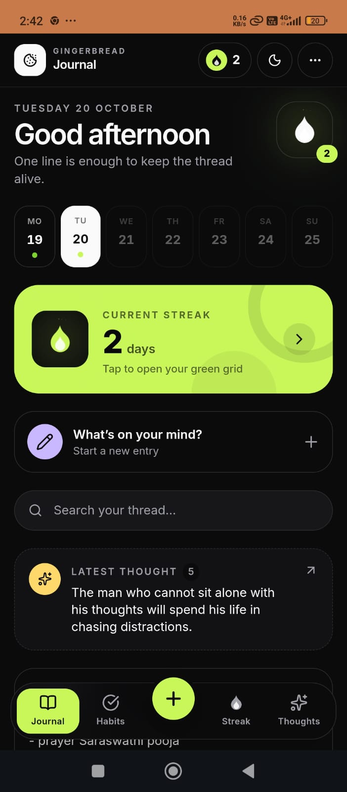
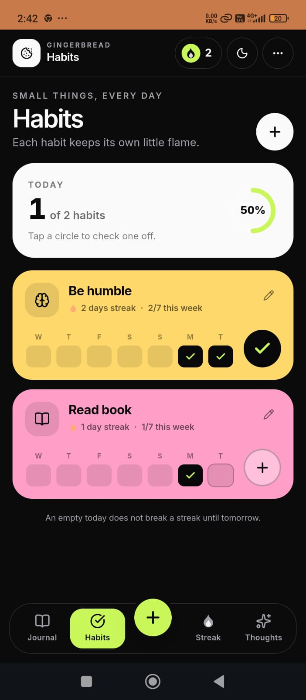
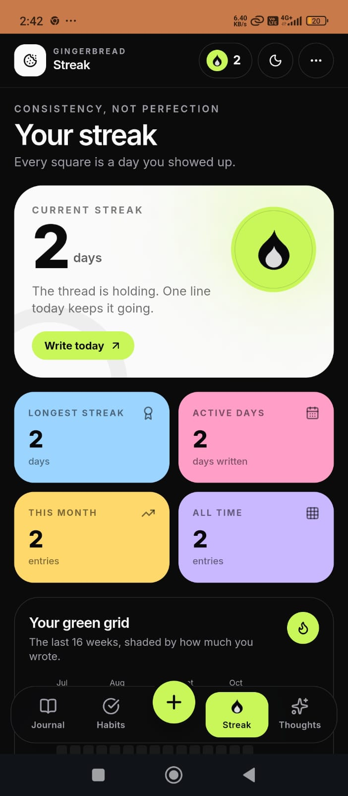

<p align="center">
  
</p>

<h1 align="center">Gingerbread</h1>

<p align="center">
  A private, <strong>end-to-end encrypted</strong> journaling web app.<br />
  Write your daily thoughts in one chronological stream — everything is
  encrypted in your browser before it ever reaches the server.
</p>

<p align="center">
  
  
  
  
  
</p>

## Screenshots

| Journal | Habits | Streak |
| :-----: | :----: | :----: |
|  |  |  |
| Your daily thread, recent days, and latest thought. | Check off small things every day and keep each flame alive. | Streak stats and the green grid of days you showed up. |

> **Status:** feature-complete for the v1 scope. All eight build milestones in
> [`PLAN.md`](./PLAN.md) are implemented: encrypted auth, entry CRUD, timeline,
> Markdown editor with autosave, client-side search, tags, PDF/Markdown/encrypted
> JSON export-restore, and PWA support with auto-lock.

## How it works

- **Zero-knowledge by design.** Your password derives two separate values in the
  browser: an *auth key* (the server stores only a hash of it) and a *master key*
  (never sent anywhere). Entries are encrypted with AES-256-GCM before upload.
- **The server is a dumb relay.** It stores ciphertext and opaque metadata, and
  can never read, search, or decrypt your entries.
- **One user, one stream.** A personal journal, not a multi-tenant product.

## Features

- **Setup & unlock** with split key derivation and a one-time recovery key.
- **Timeline** of dated entries, grouped by day, with tag filters.
- **Markdown editor** (light toolbar + preview) with debounced autosave,
  per-entry version history, and manual save (⌘/Ctrl+S).
- **Instant client-side search** across decrypted entries.
- **Export** to PDF, Markdown, and an encrypted JSON backup; restore from a
  backup file.
- **Auto-lock** after 15 minutes idle; the master key lives only in memory.
- **Installable PWA** with an offline app shell, plus light/dark/system themes.

## Tech stack

- [Next.js](https://nextjs.org) 16 (App Router) + React 19
- [Tailwind CSS](https://tailwindcss.com) v4
- [MongoDB](https://www.mongodb.com) (official driver)
- TypeScript (strict) · [Zod](https://zod.dev) · [jose](https://github.com/panva/jose)

## Getting started

```bash
pnpm install
cp .env.example .env   # then fill in the values
pnpm dev
```

Open http://localhost:3000.

### Environment variables

| Variable        | Required | Description                                            |
| --------------- | -------- | ------------------------------------------------------ |
| `MONGODB_URL`   | yes      | MongoDB connection string (Atlas or self-hosted).      |
| `MONGODB_DB`    | no       | Database name. Defaults to `gingerbread`.              |
| `SESSION_SECRET`| yes      | Random 32-byte base64 string used to sign the session.  |

Generate a session secret with:

```bash
node -e "console.log(require('crypto').randomBytes(32).toString('base64'))"
```

## Scripts

| Command          | Description                        |
| ---------------- | ---------------------------------- |
| `pnpm dev`       | Start the dev server.              |
| `pnpm build`     | Production build.                  |
| `pnpm start`     | Run the production build.          |
| `pnpm lint`      | Lint with ESLint.                  |
| `pnpm typecheck` | Type-check with `tsc --noEmit`.    |
| `pnpm test`      | Run the unit tests (Vitest).       |

Regenerate the PWA icons after changing the palette with:

```bash
node scripts/generate-icons.mjs
```

## Security notes

- The master key lives only in browser memory — never in `localStorage` or a
  cookie.
- Lost password + lost recovery key = lost data. The UI says so.
- The server necessarily sees entry *counts*, *sizes*, and *timestamps*; it never
  sees content.

## Privacy

This is an open-source, single-user app. Don't commit your `.env`.
